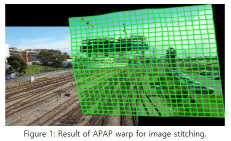
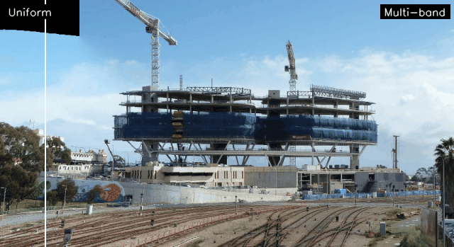
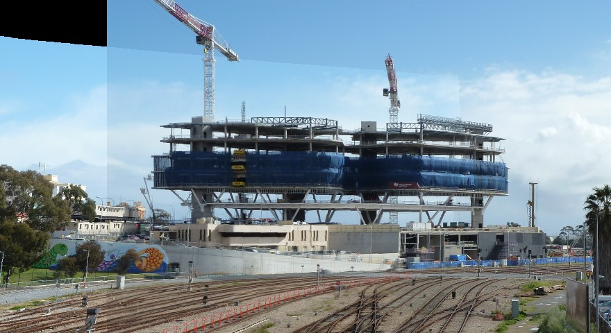
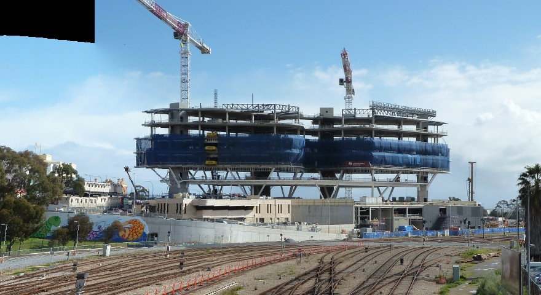
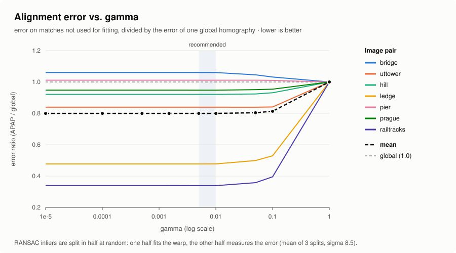
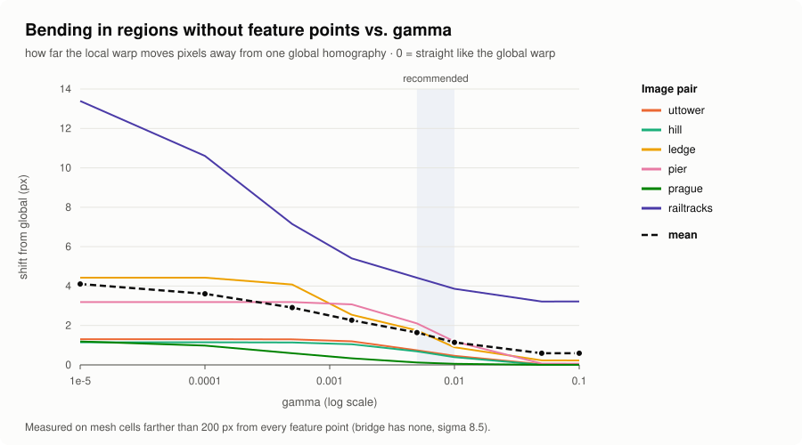
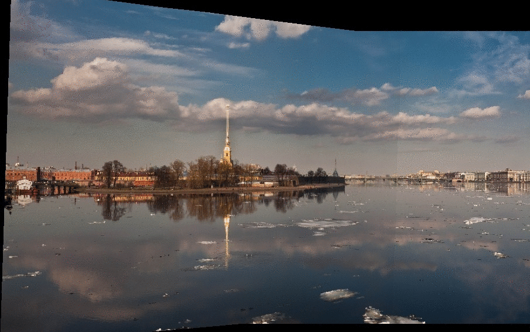
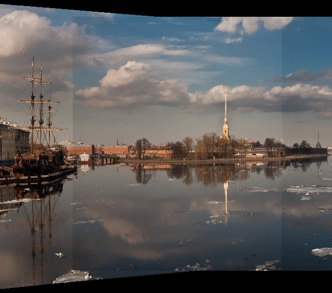

# As-Projective-As-Possible Image Stitching with Moving DLT

A Python re-implementation of APAP (local-homography warping).

This program takes a list of images and performs stitching recursively.

Official Matlab Code: https://cs.adelaide.edu.au/~tjchin/apap/


## 1. Target Research Paper

Research Paper: [LINK](https://www.cv-foundation.org/openaccess/content_cvpr_2013/papers/Zaragoza_As-Projective-As-Possible_Image_Stitching_2013_CVPR_paper.pdf)

**Zaragoza, Julio, et al. "As-projective-as-possible image stitching with moving DLT." *Proceedings of the IEEE Conference on Computer Vision and Pattern Recognition (CVPR)*. 2013.**




## 2. Quick Start

```
conda create -n apap -c conda-forge python=3.13 numpy=2.5.4 opencv=5.0.0 pillow=12.3.0 tqdm=4.70.1
conda activate apap
bash scripts/demo1.sh
```

- Windows: `scripts\demo1.bat`
- Run at the project root. Results are saved in `./results/demo1`.
- Extra options are passed to main.py. (e.g. `bash scripts/demo5.sh --multiband True`)


## 3. Usage

Three ways to give input images:

```
python main.py --img1 a.jpg --img2 b.jpg --saveroot ./results/mine
python main.py --imgs a.jpg b.jpg c.jpg --saveroot ./results/mine
python main.py --imgroot ./images/demo1 --imglist ./splits/demo1.txt --saveroot ./results/mine
```

With `--imglist`, each line of the txt file is one stitching set.

| Option | Default | Description |
|---|---|---|
| `--resize W H` | 400 300 | each input image is resized to this size |
| `--mesh_size` | 100 | # of cells per side for local homographies |
| `--gamma` | 0.0001 | weight offset in the paper (see 6.) |
| `--sigma` | 8.5 | weight bandwidth in the paper |
| `--ransac_thres` | 30 | RANSAC inlier distance (px) |
| `--ransac_sample` | 12 | # of samples per RANSAC trial |
| `--multiband` | False | multi-band blending instead of uniform blending |
| `--saveroot` | None | save directory (not saved if None) |
| `--image_show` | 0 | # of result images to show, -1 shows all |

See `option.py` for all options.

Too small input images give few feature points, which may lead to a wrong homography.


## 4. Pipeline

1. Image Loading
2. Grayscaling & SIFT (OpenCV)
3. Brute-Force KNN Matching & Ratio Test
4. RANSAC
5. Global-Homography Estimating & Final Size Extracting
6. Local-Homography Estimating (Moving DLT)
7. Mesh-based Local Warping
8. Uniform Blending (50:50), or Multi-band Blending with `--multiband True`


## 5. Blending

The paper and the official code blend images by simple averaging so that misalignments remain visible.
Multi-band blending ([Burt & Adelson, 1983](https://doi.org/10.1145/245.247)) hides the exposure difference along the overlap border.



| Uniform (50:50) | Multi-band |
|---|---|
|  |  |

(demo5, the same warped images)


## 6. Gamma

`gamma` is the lower bound of the moving DLT weights.
Cells far from feature points fall back to the global homography as gamma grows.

- Recommended: **0.005 ~ 0.01** (with sigma 8.5)
- Smaller gamma does not improve the alignment, but bends the regions without feature points more.
- Larger gamma (0.05 ~) loses alignment accuracy on scenes with large parallax.

Each colored line is one image pair, and the dashed black line is their mean.



Below 1.0, APAP aligns the images better than a single global homography.



The larger the value, the more the regions without feature points are bent.


## 7. Why do stitching recursively?

- If images are stitched sequentially from the left, the first image becomes the reference and the far side is stretched excessively.
- Recursive stitching splits the list in half and warps each half toward the middle, so the center image becomes the reference. (The paper also starts from a central image.)
- Recursive Stitching:



- Sequential Stitching:



- Limitations
  - APAP improves the alignment of each pair, but a wide panorama is still stretched toward the edges because all images are projected onto one plane.
  - Outer images are warped several times, so they lose some sharpness, and features are matched on already-stitched images.


## 8. References

### code

1. https://github.com/lxlscut/APAP_S
2. https://github.com/fredzzhang/Normalized-Eight-Point-Algorithm
3. https://cs.adelaide.edu.au/~tjchin/apap/#Source

### demo images

1. https://github.com/daeyun/Image-Stitching
2. https://github.com/opencv/opencv_extra
3. https://www.pyimagesearch.com/2018/12/17/image-stitching-with-opencv-and-python/


## 9. History

- **2020.12.28. ~ 2021.01.03.** Initial implementation
- **2026.10.15.** 1st major update
  - Local homographies are estimated in the canvas frame, as in the official code.
  - Mesh vertices are placed at the cell centers.
  - Faster RANSAC and local warping (vectorized).
  - Multi-band blending option (`--multiband`).
  - Supports recent libraries (NumPy 2, OpenCV 5).
  - Bug fixes: RANSAC trial number, error handling, mask list, `--imglist` order.
  - Demo scripts are moved to `scripts/`, and results are saved in `./results`.


